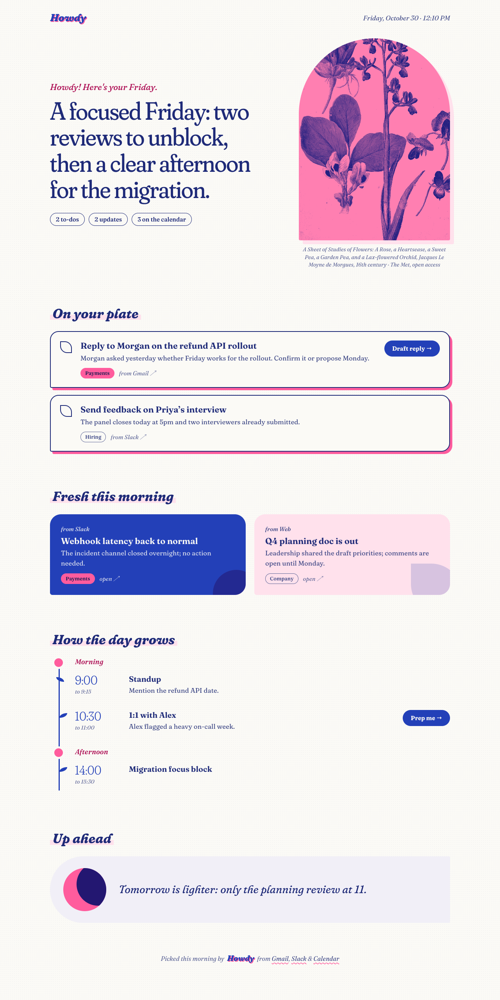
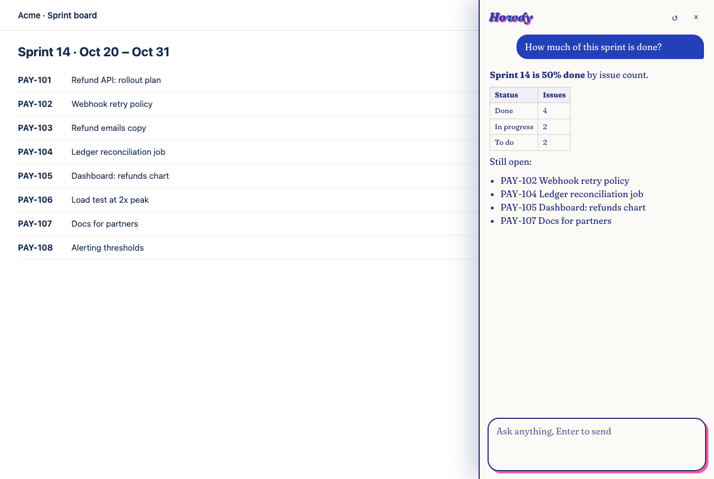
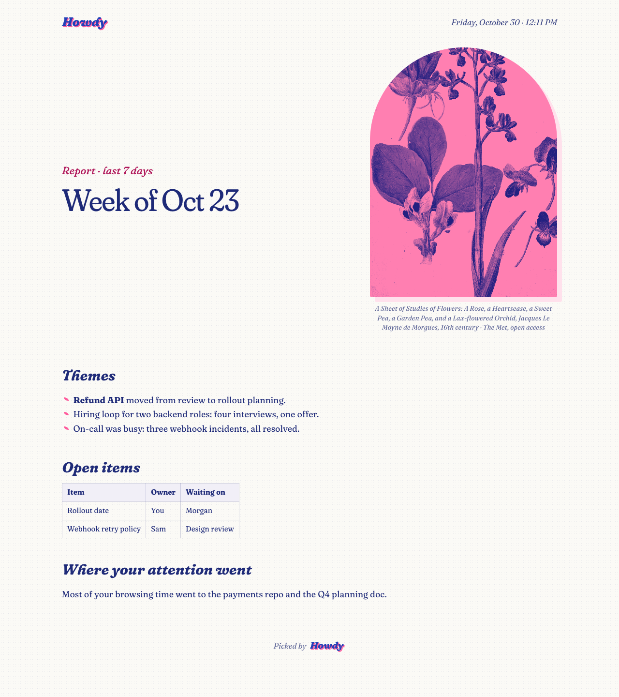
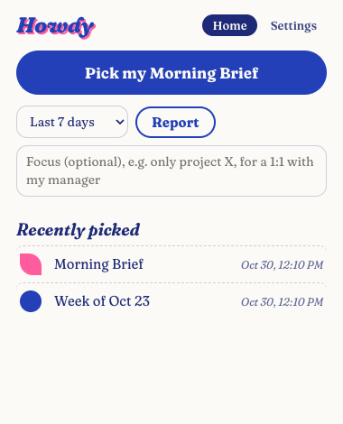
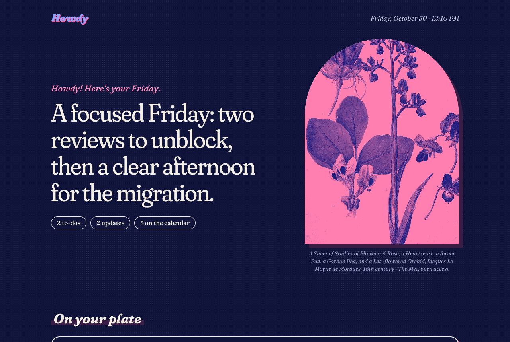
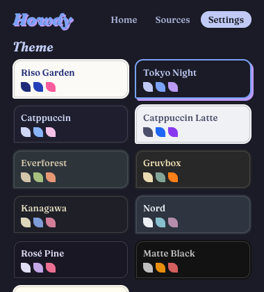
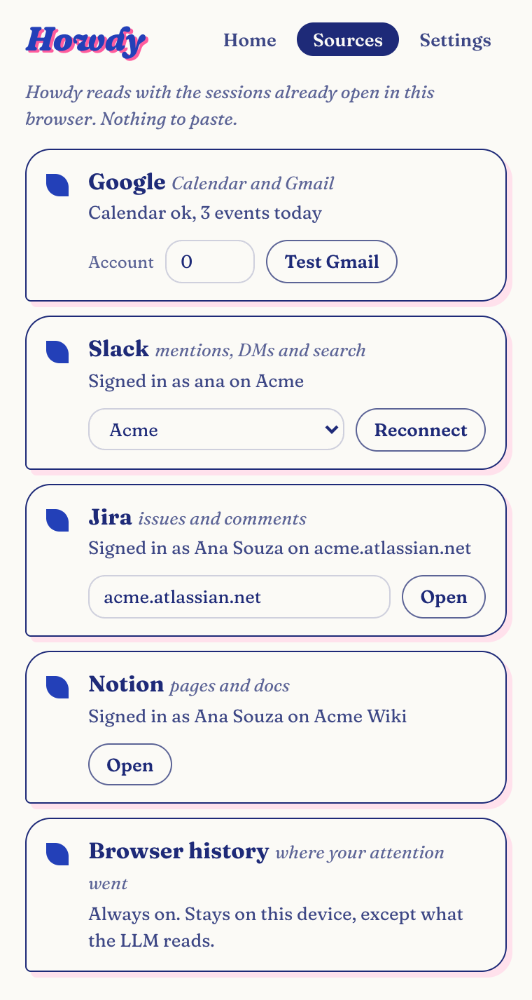
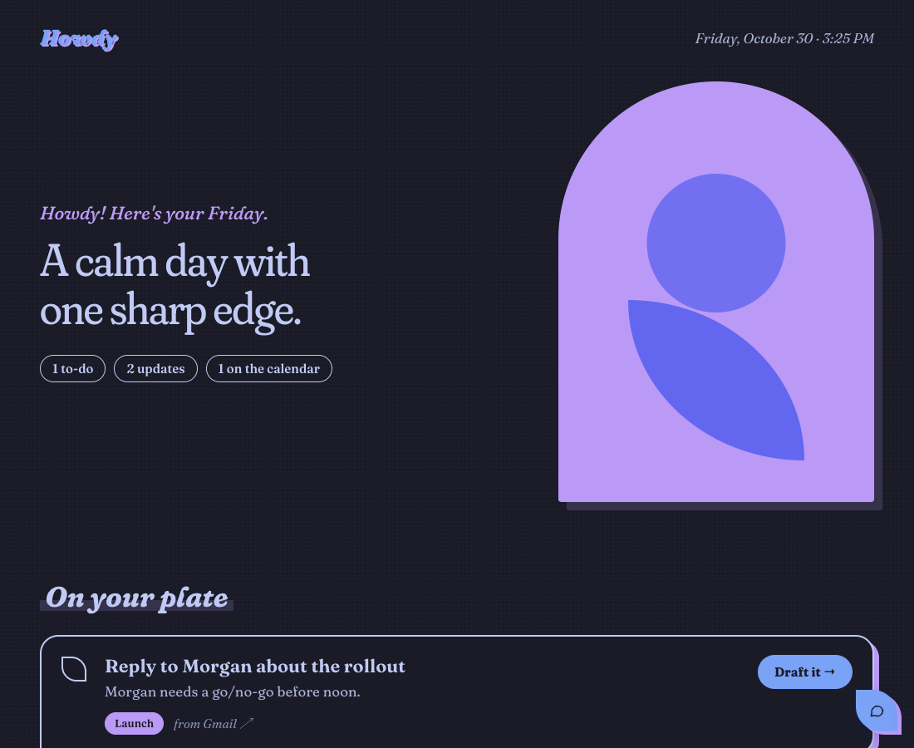
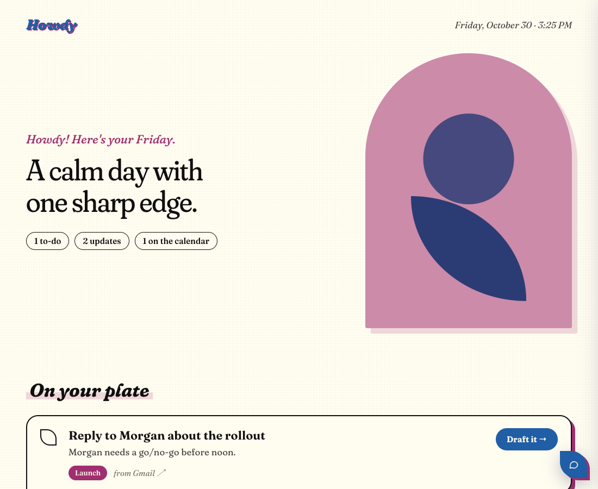

# Howdy

Morning Brief, Reports and Chat over your Google Calendar, Gmail, Slack, Jira and browser history. A browser extension for Chromium browsers that works with your own LLM.

<p align="center"></p>

## Install

Works in Chromium browsers with developer mode (Chrome, Arc, Edge, Brave). No build step and no shared secrets: each person uses their own LLM key and their own Google, Slack and Jira sessions.

1. Clone the repository:
   ```sh
   git clone https://github.com/JonRoosevelt/howdy.git
   ```
2. Open `chrome://extensions` (or the equivalent page in your browser).
3. Turn on **Developer mode**.
4. Click **Load unpacked** and pick the `howdy` folder.
5. Pin the extension, click its icon and open **Settings** and **Sources** to finish the [setup](#setup).

The browser may warn about developer-mode extensions on startup; that is expected for unpacked extensions.

### Update

Unpacked extensions do not update on their own:

```sh
cd howdy && git pull
```

Then click the reload icon on the extension's card in `chrome://extensions`.

## Setup

**LLM** (must support tool calling)
- OpenAI-compatible: OpenAI, DeepSeek (`https://api.deepseek.com`, model `deepseek-v4-flash`), OpenRouter, Groq, Gemini (`https://generativelanguage.googleapis.com/v1beta/openai`), Ollama/LM Studio (`http://localhost:11434/v1`). The Base URL field suggests these.
- Anthropic: provider `Anthropic`, e.g. model `claude-sonnet-5-5`.

On **Save** the browser asks for permission to call the LLM host. Accept it, or requests are blocked.

**Sources**
The **Sources** tab lists each connector with its live status (signed in as whom, or what is wrong). Every source reuses the session already open in the browser, so there is nothing to paste.
- **Google (Calendar + Gmail):** uses the Google account signed in to the browser. With several accounts, enter the N from `mail.google.com/mail/u/N`. **Test Gmail** also checks Gmail, which is slower.
- **Slack:** click **Connect** to open Slack on the web. If you are already signed in, Howdy picks up the session on its own. Pick the workspace. If the session expires, click **Reconnect**.
- **Jira (Cloud):** Howdy suggests the `*.atlassian.net` sites from your browser history. Pick or type yours; you only need to be signed in to it.
- **Browser history:** always on, read locally.

## Use

- **Popup** (click the icon): generate a Morning Brief or a report, and browse the history. Each brief and report opens as its own page in a new tab, with a public-domain botanical study from The Met, printed in two riso-style inks.
- **Brief page:** check off to-dos (saved), open the source, or click a suggestion button to ask the chat about it.
- **Themes:** Settings has a color theme picker (Riso Garden, Tokyo Night, Catppuccin, Gruvbox, Nord, Rosé Pine and more). The choice applies to every Howdy page, the chat and the floating button, and is kept across sessions.
- **Chat:** a blue leaf-shaped button sits at the bottom right of every page. Drag it anywhere on the screen; it stays where you leave it on every page and across sessions. It opens a panel on the right where you can chat with the agent, and the page you are on is added as context. Ask for a report and the chat writes it, saves it to the history and opens it in a new tab.

<table>
  <tr>
    <td width="50%"></td>
    <td width="50%"></td>
  </tr>
  <tr>
    <td align="center">Chat on any page, with the page as context</td>
    <td align="center">Reports open as their own page</td>
  </tr>
  <tr>
    <td></td>
    <td></td>
  </tr>
  <tr>
    <td align="center">Popup: generate and browse the history</td>
    <td align="center">Dark mode</td>
  </tr>
  <tr>
    <td></td>
    <td></td>
  </tr>
  <tr>
    <td align="center">Color themes, kept across sessions</td>
    <td align="center">Sources with live status</td>
  </tr>
  <tr>
    <td></td>
    <td></td>
  </tr>
  <tr>
    <td align="center">Tokyo Night</td>
    <td align="center">Flexoki Light</td>
  </tr>
</table>

Screenshots use sample data.

## How it works

An agent calls tools in a loop, checks whether each to-do was already handled, and returns the brief as JSON that the page renders. See [docs/architecture.md](docs/architecture.md).

The brief also runs on its own at the configured hour, or on the first browser start after it, and marks the icon with a badge.

Generated text follows the browser's language (`navigator.language`).

Everything is stored in `chrome.storage.local`, API keys included. Data only leaves the browser to reach the source services and the configured LLM.

## Check

```sh
npm i
npx playwright install chromium
npm run check
```

Loads the extension in Chromium with a mocked LLM, Slack, Jira, Calendar and Gmail, and validates the tool loop, the session capture, the brief and report pages, the history, the chat panel on a regular site, and dragging the chat button (kept inside the window, remembered across pages, no panel opening after a drag).

## More

- [docs/architecture.md](docs/architecture.md): how each part works
- [ROADMAP.md](ROADMAP.md): next steps
